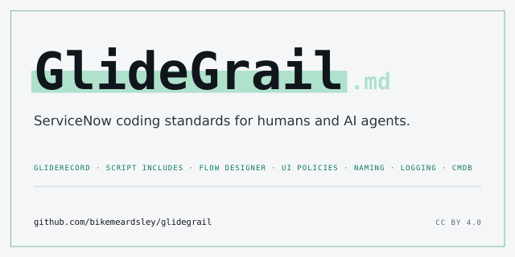
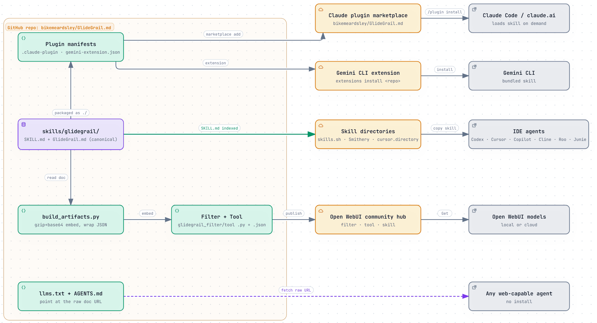

<p align="center">
  <a href="./skills/glidegrail/GlideGrail.md"></a>
</p>

<p align="center">
  <a href="https://github.com/bikemeardsley/GlideGrail.md/releases/latest"></a>
  <a href="https://skills.sh/bikemeardsley/GlideGrail.md/glidegrail"></a>
  <a href="https://cursor.directory/plugins/glidegrail-servicenow-coding-standards"></a>
  <a href="https://smithery.ai/skills/bikemeardsley/glidegrail"></a>
  <a href="USAGE.md#gemini--antigravity"></a>
  <a href="https://github.com/ServiceNow/ServiceNowDocs"></a>
  <br>
  <a href="https://openwebui.com/posts/glidegrail_servicenow_coding_standards_enforcement_00c849c7"></a>
  <a href="https://openwebui.com/posts/glidegrail_servicenow_coding_standards_lookup_871d3d99"></a>
  <a href="https://openwebui.com/posts/glidegrail_d3af0156"></a>
  <br>
  <a href="LICENSE"></a>
  <a href="https://buymeacoffee.com/bikemeardsley"></a>
  <a href="https://www.als.net/donate/"></a>
</p>

Most ServiceNow best practice material is scattered across community posts, docs, tribal
knowledge, or just not widely known, and written to be read by a human. [`GlideGrail.md`](./skills/glidegrail/GlideGrail.md) consolidates years of experience and common rules
into a single reference written to be consumed by a model: concrete, directive, and
specific enough to change what your AI assistant (Claude, ChatGPT, Codex, Gemini, Copilot,
Cursor, Cline, Roo Code, JetBrains, Microsoft 365 Copilot, Open WebUI) actually produces.

Equally useful as a human reference or a review checklist.

## Quick start

**Setting this up in your assistant?** See [USAGE.md](./USAGE.md) for step-by-step setup for every
tool (Claude, ChatGPT, Codex, GitHub Copilot, Microsoft 365 Copilot, Cursor, Cline, Roo Code,
JetBrains, Gemini, Open WebUI), and which load method to use for each.

The quickest installs:

**Claude Code** - install as a plugin:
```bash
/plugin marketplace add bikemeardsley/GlideGrail.md
/plugin install glidegrail@glidegrail
```
**claude.ai (web or desktop app)** - open **Customize → Plugins → Add → Add marketplace**, enter
`bikemeardsley/GlideGrail.md`, and install **glidegrail**. Third-party marketplaces don't
auto-update by default; see [USAGE.md](./USAGE.md#ship-it-as-a-skill-recommended) to turn it on.

**Cursor** - install from [cursor.directory](https://cursor.directory/plugins/glidegrail-servicenow-coding-standards).

**Optional companion — live ServiceNow docs, no setup:** a separate plugin,
[`servicenow-docs`](https://github.com/bikemeardsley/claude-servicenow-docs), gives Claude
direct access to ServiceNow's official product documentation. Nothing to clone or download and
nothing to keep up to date — it reads the docs live from GitHub, so answers reflect what
ServiceNow publishes today:
```bash
/plugin marketplace add bikemeardsley/claude-servicenow-docs
/plugin install servicenow-docs@servicenow-docs
```
Requires [`uv`](https://docs.astral.sh/uv/) (a one-line install) and a restart of Claude, plus
one extra config step on Claude Desktop — see
[that repo](https://github.com/bikemeardsley/claude-servicenow-docs) for the two-minute setup.

**Antigravity CLI** — install as a plugin:
```bash
agy plugin install https://github.com/bikemeardsley/GlideGrail.md
```

**Gemini CLI** — install as an extension:
```bash
gemini extensions install https://github.com/bikemeardsley/GlideGrail.md --auto-update
```

**Open WebUI** — install as a Function that auto-injects the standards for any model (local or cloud):
one click via the community hub — [Enforcement Filter](https://openwebui.com/posts/glidegrail_servicenow_coding_standards_enforcement_00c849c7) (recommended), plus the optional
[Lookup Tool](https://openwebui.com/posts/glidegrail_servicenow_coding_standards_lookup_871d3d99) — then enable it and toggle **Global**. No admin rights? Install the [GlideGrail Skill](https://openwebui.com/posts/glidegrail_d3af0156) from the hub instead. Details: [USAGE.md](./USAGE.md#open-webui).

**Any web-capable agent** — no install needed: tell it to fetch
`https://raw.githubusercontent.com/bikemeardsley/GlideGrail.md/main/llms.txt` and follow the
linked standards.

Every other tool loads the skill from [`skills/glidegrail/`](./skills/glidegrail/) (raw standards:
[`GlideGrail.md`](./skills/glidegrail/GlideGrail.md)) see [USAGE.md](./USAGE.md) for the steps.

## How it reaches your assistant

One canonical folder, [`skills/glidegrail/`](./skills/glidegrail/), feeds every channel, so every
assistant gets the same standards:

<p align="center">
  
</p>

## What's inside

[`GlideGrail.md`](./skills/glidegrail/GlideGrail.md) covers, as enforceable conventions:

| Area | Covers |
|---|---|
| **Ground rules & scope** | When an agent should confirm vs. build, scoped-app-first discipline, configuration over hardcoding (no hardcoded URLs or sys_ids), recognising and flagging technical debt before incurring it, code readability, and a "Do Not Use" table of banned patterns |
| **Naming** | Tables, fields, Script Includes, Business Rules, variables, update sets, and widgets — with a configurable `PREFIX` |
| **Server-side scripting** | GlideRecord / GlideAggregate patterns, GlideElement handling, Script Include structure, GlideAjax, constants, and performance at scale |
| **Client-side** | UI Policies vs. Client Scripts vs. Data Policies, GlideForm, GlideAjax, and UI Actions across classic forms and Workspaces |
| **Automation** | Business Rules (timing, order, recursion guards), Events, Scheduled Jobs, and Flow Designer — what belongs in a flow vs. a script |
| **Security** | ACL design, hardening, and debugging; integration user and data security |
| **Logging, errors & ops** | A 3-tier logging convention, error-handling return contracts, and pre-go-live review routines (logs, queues) |
| **Data & migration** | Data model conventions — table/field/choice design (default vs. calculated vs. derived, state-field rules) and database views — plus CMDB, Import Sets & Transform Maps (staging-first), and Update Sets (promotion, fix scripts) |
| **Catalog, platform UX & i18n** | Service Catalog (items vs. record producers), MRVS, attachments, system properties, notifications, messages/i18n, and UI Builder |
| **Service Portal** | Widgets, AngularJS providers, server communication, client-side state, SCSS, BEM, accessibility (WCAG), and Moment.js i18n |
| **Integrations** | Interface design and non-repudiation, Scripted REST APIs, IntegrationHub & custom spokes, OAuth 2.0, and LDAP user import |
| **Testing** | The Automated Test Framework — coverage expectations, suite hierarchy, reusable base tests, and running suites via the CI/CD API |

> **Works on its own; pairs well with the official ServiceNow sources.** [`GlideGrail.md`](./skills/glidegrail/GlideGrail.md) is the
> judgment layer (how you want code written) and needs nothing else to be useful. When you
> want to go further, two official, free companions complement it:
> - [ServiceNow product docs in markdown](https://github.com/ServiceNow/ServiceNowDocs) (LLM-optimized) for authoritative, current platform behavior, and
> - [ServiceNow now-sdk agent skills](https://github.com/ServiceNow/sdk) for live Fluent/SDK mechanics when you're building with the ServiceNow SDK.

## License

Licensed under a [Creative Commons Attribution 4.0 International License (CC BY 4.0)](https://creativecommons.org/licenses/by/4.0/).
Free to use, share, and adapt, including commercially, with attribution.

## Support

If [`GlideGrail.md`](./skills/glidegrail/GlideGrail.md) saves you time and/or you find it useful, please give this repo a Star. You can also sponsor the project by 
[buying me a coffee](https://buymeacoffee.com/bikemeardsley) or donating to [ALS Research](https://www.als.net/donate/) which is a cause that is very personal to me. Entirely optional, always
appreciated!

---

*Maintained by [Michael Beardsley](https://github.com/bikemeardsley). Built from real
ServiceNow development.*
